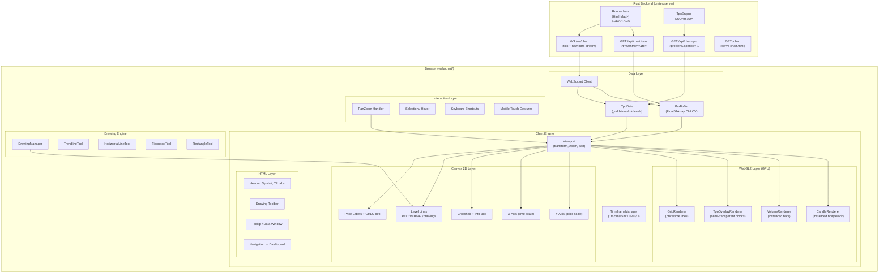
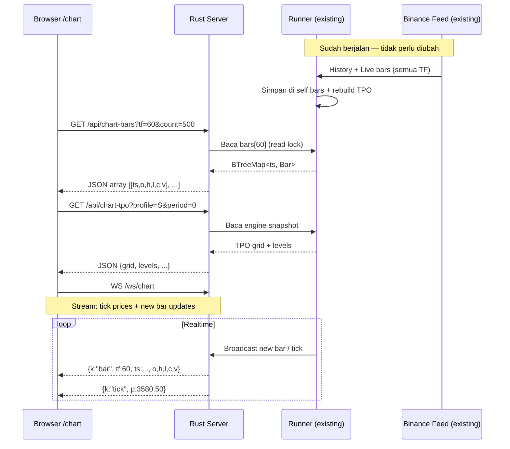
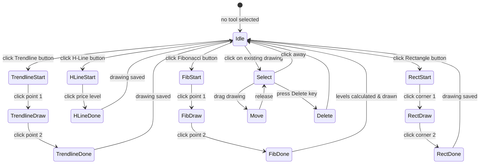

# 📊 MCDash Pro Chart — Full Professional Trading Analysis
## Gaya ATAS / DeepChart

---

## Visi

Halaman chart trading profesional yang berdiri sendiri (`/chart`), dengan **candlestick chart sebagai fondasi utama** dan **TPO/Market Profile sebagai overlay**, dilengkapi drawing tools, multi-timeframe, dan interaksi penuh — semua terintegrasi dengan data Binance realtime yang sudah ada di mcdash.

```
┌─────────────────────────────────────────────────────────────────────┐
│  XAUUSDT  3580.50 ▲+2.30  │ 1m  5m 15m [1H] 4H  D │ 🔧 ⚙ Dashboard  │
├────────────────────────────────────────────────────────┬────────────┤
│                                                        │ 3605.00    │
│        ╭─╮                                             │            │
│   ╭─╮  │█│ ╭─╮                      ╭─╮               │ 3600.00    │
│   │█│  │█│ │█│ ╭─╮              ╭─╮  │░│               │            │
│   │█│  │█│ │█│ │█│ ╭─╮    ╭─╮  │█│  │░│  ╭─╮          │ 3595.00    │
│   │█│  ╰─╯ │█│ │█│ │█│╭─╮ │░│  │█│  │░│  │░│ ╭─╮      │ ─ ─ VAH   │
│   ╰─╯      ╰─╯ │█│ │█││░│ │░│  │█│  ╰─╯  │░│ │░│      │ 3590.00    │
│                 ╰─╯ ╰─╯│░│ ╰─╯  ╰─╯       ╰─╯ ╰─╯      │            │
│                     ╰─╯                               │ ─── POC     │
│   ┃AABB ┃                                              │ 3585.00    │
│   ┃AABBC┃    ← TPO Profile Overlay (semi-transparent) │            │
│   ┃AABBC┃CC                                            │ 3580.00    │
│   ┃AABBC┃CCDD                                          │ ─ ─ VAL   │
│   ┃ ABB ┃CCDD                                          │ 3575.00    │
│   ┃ AB  ┃ CD                                           │            │
│   ┃  B  ┃                                              │ 3570.00    │
│────────────────────────────────────────────────────────│            │
│  ████▄▄███▄▄█████▄████▄▄▄██████▄████▄████▄▄████████   │ Volume     │
├────────────────────────────────────────────────────────┴────────────┤
│  10:30    11:00    11:30    12:00    12:30    13:00    13:30        │
├────────────────────────────────────────────────────────────────────┤
│  📏 Trendline │ ─ Horizontal │ 📐 Fibonacci │ ▭ Rectangle │ ✕ Clear │
└────────────────────────────────────────────────────────────────────┘
```

---

## Arsitektur Komponen



---

## Data Flow

### Memanfaatkan Infrastruktur Yang Sudah Ada

Backend mcdash **sudah menyimpan** semua OHLCV bars di `Runner.bars: HashMap<i64, BTreeMap<i64, Bar>>` — ini data yang sama persis yang dipakai untuk menghitung TPO. Kita hanya perlu **meng-expose-nya** lewat API baru.



### API Endpoints Baru

| Endpoint | Method | Deskripsi |
|----------|--------|-----------|
| `GET /chart` | GET | Serve `chart.html` |
| `GET /api/chart-bars` | GET | OHLCV bars: `?tf=60&count=500&before=<ts>` |
| `GET /api/chart-tpo` | GET | TPO grid: `?profile=S&period=-1` (atau `0`=developing) |
| `GET /api/chart-drawings` | GET | Saved drawings (JSON, localStorage fallback) |
| `POST /api/chart-drawings` | POST | Save drawings |
| `WS /ws/chart` | WS | Realtime: bars + ticks + TPO updates |

---

## Rendering Architecture — Hybrid WebGL + Canvas

### Layer 1: WebGL2 (GPU) — Data Berat

#### Candlestick Renderer (Instanced)
Setiap candle = **3 instances**: body rect + upper wick line + lower wick line

```
Per instance attributes (Float32):
  x:      time position (bar index)
  y_top:  max(open, close)
  y_bot:  min(open, close)
  y_high: high (wick)
  y_low:  low (wick)
  color:  0.0=bearish(red), 1.0=bullish(green)
```

**Performa**: 1,000 candles = 3,000 instances = 1 draw call, <1ms GPU

#### Volume Renderer (Instanced)
Setiap volume bar = 1 instance rect di panel bawah

#### TPO Overlay Renderer (Instanced)
TPO blocks semi-transparan di atas candlestick, dengan alpha blending

#### Grid Renderer
Garis horizontal (price levels) dan vertikal (time marks)

### Layer 2: Canvas 2D — Teks & Anotasi

| Komponen | Fungsi |
|----------|--------|
| **Y-Axis** | Price scale di sisi kanan, draggable untuk zoom vertikal |
| **X-Axis** | Time labels di bawah chart |
| **Crosshair** | Garis horizontal + vertikal mengikuti cursor |
| **Info Box** | OHLCV data bar di bawah crosshair |
| **Level Lines** | POC/VAH/VAL dashed lines + price tags |
| **Drawing Lines** | Trendlines, Fibonacci, horizontal lines |
| **Current Price** | Garis horizontal + label di Y-axis |

### Layer 3: HTML/CSS — UI Controls

Header, toolbar, tooltips, timeframe tabs, drawing tool selector

---

## Color Scheme — ATAS Dark Theme

```css
:root {
  /* Base */
  --chart-bg:     #131722;    /* Deep navy background */
  --panel-bg:     #1E222D;    /* Panel/toolbar */
  --grid:         #2A2E39;    /* Grid lines */
  --grid-major:   #363A45;    /* Major grid lines */
  --text:         #D1D4DC;    /* Primary text */
  --text-dim:     #787B86;    /* Muted text */
  --border:       #2A2E39;    /* Borders */

  /* Candles */
  --bull:         #26A69A;    /* Bullish candle (teal-green) */
  --bull-wick:    #26A69A;
  --bear:         #EF5350;    /* Bearish candle (red) */
  --bear-wick:    #EF5350;

  /* Volume */
  --vol-bull:     #26A69A40;  /* 25% opacity */
  --vol-bear:     #EF535040;

  /* Levels */
  --poc:          #FF5252;    /* POC line (bright red) */
  --vah:          #FFD700;    /* VAH line (gold) */
  --val:          #FFD700;    /* VAL line (gold) */
  --va-fill:      #1A237E30;  /* VA area (deep blue 19%) */

  /* TPO blocks (sequential gradient A→Z) */
  --tpo-a: #4FC3F7; --tpo-b: #4DD0E1; --tpo-c: #4DB6AC;
  --tpo-d: #66BB6A; --tpo-e: #81C784; --tpo-f: #AED581;
  --tpo-g: #DCE775; --tpo-h: #FFF176; --tpo-i: #FFD54F;
  /* ... cool→warm gradient ... */

  /* Interactive */
  --crosshair:    #9598A1;    /* Crosshair lines */
  --current-px:   #2962FF;    /* Current price line (blue) */
  --selection:    #2962FF40;  /* Selection highlight */

  /* Drawings */
  --draw-trend:   #2962FF;    /* Trendline */
  --draw-hline:   #787B86;    /* Horizontal line */
  --draw-fib:     #9C27B0;    /* Fibonacci */
  --draw-rect:    #2962FF30;  /* Rectangle fill */
}
```

---

## Drawing Tools

### Implementasi



### Drawing Data Model

```typescript
interface Drawing {
  id: string;
  type: 'trendline' | 'hline' | 'fibonacci' | 'rectangle';
  points: { time: number; price: number }[];  // 1-2 points
  style: { color: string; width: number; dash?: number[] };
  visible: boolean;
  locked: boolean;
}
```

### Fibonacci Retracement Levels
```
100.0% ─────────── (point 1)
 78.6% ───────────
 61.8% ───────────  ← Golden ratio
 50.0% ───────────
 38.2% ───────────
 23.6% ───────────
  0.0% ─────────── (point 2)
```

---

## Multi-Timeframe

Memanfaatkan data yang **sudah di-fetch** oleh Runner. Binance feed sudah mengambil 1m dan/atau 5m bars — kita perlu menambahkan kemampuan untuk **aggregate ke timeframe lebih tinggi** di frontend:

```
1m bars (from server) → aggregate → 5m, 15m, 30m, 1H, 4H, D candles
```

Atau request timeframe spesifik dari server yang sudah punya data:

```
GET /api/chart-bars?tf=1    → 1-minute bars
GET /api/chart-bars?tf=5    → 5-minute bars
GET /api/chart-bars?tf=60   → 1-hour bars (aggregated server-side)
GET /api/chart-bars?tf=240  → 4-hour bars
GET /api/chart-bars?tf=1440 → daily bars
```

---

## File Structure

```
web/
├── chart.html                      # Halaman chart standalone
├── src/
│   ├── client.ts                   # (existing) dashboard
│   ├── chart/
│   │   ├── index.ts                # Entry point chart
│   │   ├── ChartApp.ts             # Top-level orchestrator
│   │   ├── state/
│   │   │   ├── BarBuffer.ts        # OHLCV data store (typed arrays)
│   │   │   ├── TpoData.ts          # TPO grid data
│   │   │   ├── DrawingStore.ts     # Drawings persistence
│   │   │   └── ChartState.ts       # UI state (TF, zoom, mode)
│   │   ├── viewport/
│   │   │   ├── Viewport.ts         # World↔Screen transform
│   │   │   ├── TimeScale.ts        # X-axis: time → pixel
│   │   │   └── PriceScale.ts       # Y-axis: price → pixel
│   │   ├── gl/
│   │   │   ├── GLContext.ts        # WebGL2 setup
│   │   │   ├── ShaderProgram.ts    # Compile/link helpers
│   │   │   ├── CandleRenderer.ts   # Instanced candlesticks
│   │   │   ├── VolumeRenderer.ts   # Volume histogram
│   │   │   ├── TpoRenderer.ts      # TPO overlay blocks
│   │   │   ├── GridRenderer.ts     # Grid lines
│   │   │   └── shaders/
│   │   │       ├── candle.vert / candle.frag
│   │   │       ├── volume.vert / volume.frag
│   │   │       ├── tpo.vert / tpo.frag
│   │   │       └── grid.vert / grid.frag
│   │   ├── overlay/
│   │   │   ├── AxisRenderer.ts     # Canvas 2D: Y/X axis
│   │   │   ├── CrosshairRenderer.ts
│   │   │   ├── LevelRenderer.ts    # POC/VAH/VAL lines
│   │   │   ├── PriceLineRenderer.ts # Current price marker
│   │   │   ├── DrawingRenderer.ts  # Trend/Fib/HLine/Rect
│   │   │   └── InfoBox.ts          # OHLCV data display
│   │   ├── tools/
│   │   │   ├── ToolManager.ts      # Active tool state machine
│   │   │   ├── TrendlineTool.ts
│   │   │   ├── HLineTool.ts
│   │   │   ├── FibonacciTool.ts
│   │   │   └── RectangleTool.ts
│   │   ├── interaction/
│   │   │   ├── PanZoom.ts          # Mouse + touch handlers
│   │   │   ├── Keyboard.ts         # Shortcuts
│   │   │   └── AxisDrag.ts         # Drag Y-axis to zoom price
│   │   ├── net/
│   │   │   ├── ChartClient.ts      # WebSocket + REST client
│   │   │   └── BarAggregator.ts    # Aggregate 1m → higher TF
│   │   └── util/
│   │       ├── Color.ts            # Palette & theme
│   │       ├── Format.ts           # Price/time formatting
│   │       └── Math.ts             # Clamp, lerp, etc.
│   └── gen/                        # (existing) ts-rs types
└── dist/
```

---

## Backend Changes (Rust)

### Perubahan di `crates/server/src/http.rs`

```rust
// Routes baru
.route("/chart", get(chart_page))
.route("/chart/{path:.*}", get(chart_assets))
.route("/api/chart-bars", get(chart_bars))
.route("/api/chart-tpo", get(chart_tpo))
.route("/api/chart-drawings", get(get_drawings).post(save_drawings))
.route("/ws/chart", get(ws_chart_upgrade))
```

### Perubahan di `crates/server/src/app.rs`

```rust
pub struct Shared {
    // ... existing fields ...
    // Tambahan: expose bars untuk chart (read-only view)
    pub chart_bars: HashMap<i64, Bars>,  // clone dari Runner.bars
}
```

### Aggregation di Server

```rust
/// Aggregate 1m bars ke timeframe lebih tinggi
fn aggregate_bars(bars_1m: &Bars, target_tf_sec: i64) -> Bars {
    let mut out = Bars::new();
    for (&ts, &bar) in bars_1m {
        let bucket = ts - (ts % target_tf_sec);
        out.entry(bucket)
            .and_modify(|b: &mut Bar| {
                b.h = b.h.max(bar.h);
                b.l = b.l.min(bar.l);
                b.c = bar.c;  // latest close
                b.v += bar.v;
            })
            .or_insert(bar);
    }
    out
}
```

---

## Implementasi — 5 Fase

### Phase 1: Candlestick Foundation 🕯️
**Goal**: Render candlestick chart statis yang bisa di-zoom/pan

| Task | File | Deskripsi |
|------|------|-----------|
| 1.1 | `chart.html` | Layout HTML: header + canvas stack + toolbar |
| 1.2 | `http.rs` | Routes: `/chart`, `/api/chart-bars` |
| 1.3 | `app.rs` | Expose `Runner.bars` ke `Shared` |
| 1.4 | `GLContext.ts` | WebGL2 init + shader compile |
| 1.5 | `Viewport.ts` | World↔screen transform matrix |
| 1.6 | `CandleRenderer.ts` | Instanced candle body + wicks |
| 1.7 | `VolumeRenderer.ts` | Volume histogram panel |
| 1.8 | `GridRenderer.ts` | Price/time grid lines |
| 1.9 | `AxisRenderer.ts` | Canvas 2D: price Y-axis + time X-axis |
| 1.10 | `PanZoom.ts` | Mouse drag pan + wheel zoom |
| 1.11 | `ChartClient.ts` | Fetch bars + WebSocket tick |

**Deliverable**: Chart candlestick interaktif dengan volume, zoom/pan, real-time price

### Phase 2: Crosshair + Multi-TF + Info ✚
| Task | Deskripsi |
|------|-----------|
| 2.1 | Crosshair snap ke candle + price level display |
| 2.2 | OHLCV info box (top-left) |
| 2.3 | Timeframe selector tabs (1m/5m/15m/1H/4H/D) |
| 2.4 | Bar aggregation (1m → higher TF) |
| 2.5 | Current price horizontal line + Y-axis label |
| 2.6 | Auto-scroll mengikuti bar terbaru |

### Phase 3: TPO Overlay 📊
| Task | Deskripsi |
|------|-----------|
| 3.1 | `/api/chart-tpo` endpoint |
| 3.2 | TpoRenderer: semi-transparent colored blocks |
| 3.3 | POC/VAH/VAL dashed level lines |
| 3.4 | Session separator vertical lines |
| 3.5 | Toggle TPO overlay on/off |
| 3.6 | Naked POC extension lines |

### Phase 4: Drawing Tools 📐
| Task | Deskripsi |
|------|-----------|
| 4.1 | ToolManager state machine |
| 4.2 | Horizontal Line tool |
| 4.3 | Trendline tool |
| 4.4 | Fibonacci retracement tool |
| 4.5 | Rectangle / zone tool |
| 4.6 | Drawing selection, move, delete |
| 4.7 | Persist drawings (localStorage + optional server) |

### Phase 5: Polish ✨
| Task | Deskripsi |
|------|-----------|
| 5.1 | Mobile touch: pinch zoom, momentum scroll |
| 5.2 | Y-axis drag to zoom price scale |
| 5.3 | Keyboard shortcuts |
| 5.4 | Screenshot / export PNG |
| 5.5 | Canvas 2D fallback (no WebGL) |
| 5.6 | Navigation Dashboard ↔ Chart |

---

## Keyboard Shortcuts

| Key | Aksi |
|-----|------|
| `+` / `-` | Zoom in/out |
| `←` `→` | Pan time |
| `↑` `↓` | Pan price |
| `Home` | Go to latest / auto-scroll |
| `1`-`6` | Switch TF: 1m/5m/15m/1H/4H/D |
| `T` | Trendline tool |
| `H` | Horizontal line tool |
| `F` | Fibonacci tool |
| `R` | Rectangle tool |
| `Esc` | Cancel tool / deselect |
| `Delete` | Delete selected drawing |
| `P` | Toggle TPO overlay |
| `C` | Toggle crosshair |

---

> [!IMPORTANT]
> **Setuju dengan arsitektur ini?** Klik **Proceed** dan saya mulai membangun **Phase 1** — fondasi candlestick chart interaktif dengan WebGL rendering, volume bars, zoom/pan, dan realtime data.
>
> Estimasi Phase 1: ~15-20 file baru (TypeScript + Rust), menghasilkan chart candlestick yang sudah bisa dipakai dan interaktif.
